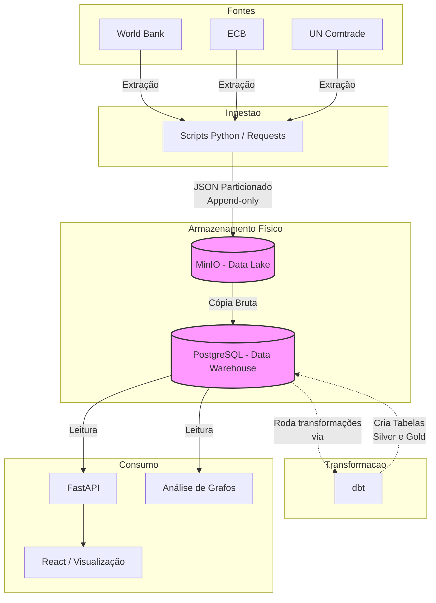
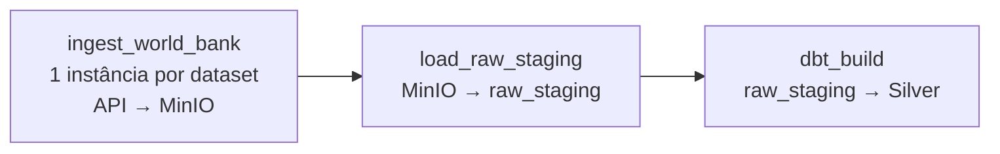

# Proposta Arquitetural: Projeto Economia Global (GEDP)

## 1. Visão Geral
A plataforma coleta automaticamente dados de diferentes instituições globais, mantém o histórico bruto, padroniza e valida a qualidade dos dados, transforma-os em modelos analíticos e os disponibiliza para consultas. O objetivo é fornecer uma visão integrada sobre mercados, macroeconomia e comércio internacional, permitindo a exploração das relações comerciais e a análise de indicadores financeiros entre países.

## 2. Requisitos do Sistema

### 2.1. Requisitos Funcionais (RF)
* **RF01:** O sistema deve coletar indicadores econômicos e comerciais de fontes públicas via APIs (ex: World Bank).
* **RF02:** O sistema deve preservar o dado bruto original, sem nenhuma alteração, garantindo o registro histórico da extração.
* **RF03:** O sistema deve padronizar identificadores (como códigos ISO de países), unidades de medida, moedas e formatos de data de diferentes fontes.
* **RF04:** O sistema deve validar a qualidade dos dados, impedindo a propagação de duplicatas e alertando sobre falhas de tipagem.
* **RF05:** O sistema deve cruzar indicadores de diferentes instituições em um modelo unificado (camada analítica).
* **RF06:** O sistema deve permitir a consulta de indicadores históricos através de uma API REST.
* **RF07:** O sistema deve fornecer abstrações para análises de grafos (Network Analysis), mapeando países como nós e fluxos de importação/exportação como arestas.
* **RF08:** O sistema deve expor os dados em uma interface web com visualizações interativas.

### 2.2. Requisitos Não Funcionais (RNF)
* **RNF01 — Idempotência:** A execução repetida de um mesmo pipeline de ingestão ou transformação não deve gerar dados duplicados.
* **RNF02 — Reprocessamento:** Deve ser possível reprocessar todo o histórico a partir da camada bruta (Bronze) caso haja mudanças nas regras de negócio ou falhas.
* **RNF03 — Rastreabilidade:** Qualquer dado servido na ponta final deve ter sua linhagem (linage) rastreável até o arquivo bruto de origem e o momento da extração.
* **RNF04 — Resiliência a Nulos:** O sistema deve suportar lacunas históricas (valores nulos em séries temporais) sem inferir valores falsos como zero.
* **RNF05 — Isolamento de Ambientes:** O motor de transformação (dbt) deve operar de forma isolada, não impactando a disponibilidade da API de leitura.

## 3. Estratégia de Dados e Atualização

O processamento é dividido no padrão Medallion (Bronze, Silver, Gold), com separação clara entre armazenamento de arquivos e o Data Warehouse relacional.

* **Bronze (Raw Data):** 
  * **Onde:** Object Storage (MinIO).
  * **Formato:** Original da fonte (ex: JSON, CSV).
  * **Estratégia:** *Append-only* com particionamento lógico (`fonte/dataset/ano/mes/dia/extracao.json`). Funciona como um repositório imutável (Data Lake).
* **Silver (Cleaned Data):**
  * **Onde:** PostgreSQL.
  * **Motor de Transformação:** dbt (data build tool).
  * **O que é feito:** "Achatamento" (flatten) de JSONs em formato tabular, tipagem forte, padronização de códigos de países (ISO-3), filtragem de regiões inválidas e aplicação de *upserts* baseados em chave primária (`iso3 + year + indicator_id`) para lidar com atualizações retroativas da fonte.
* **Gold (Analytics):**
  * **Onde:** PostgreSQL.
  * **Motor de Transformação:** dbt.
  * **O que é feito:** Tabelas fatos e dimensões, agregações, e views otimizadas para consumo de APIs e algoritmos analíticos (ex: matrizes de fluxos para análise de redes complexas).

## 4. Arquitetura do Projeto



## 5. Orquestração

### 5.1. Uma responsabilidade por componente

Cada componente da plataforma existe para resolver um problema específico. O Airflow foi adicionado depois que o pipeline já funcionava de ponta a ponta, executado manualmente, para resolver os problemas que sobravam: **quando** rodar, **em que ordem** e **o que fazer quando algo falha**.

| Componente | Responsável por | Não é responsável por |
| :--- | :--- | :--- |
| **Python** (`src/`) | Ingestão (API → MinIO) e carga (MinIO → PostgreSQL), com paginação, retry HTTP e manifest por execução | Decidir quando rodar ou o que vem depois |
| **MinIO** | Armazenamento bruto e imutável (Bronze): um snapshot por `run_id` | Consultas ou transformações |
| **PostgreSQL** | Staging (`raw_staging`) e Data Warehouse (`analytics`, `silver`) | Lógica de negócio fora do SQL |
| **dbt** (`dbt/`) | Transformação (staging → intermediate → Silver), contratos de dados e testes de qualidade | Mover dados entre sistemas ou agendar execuções |
| **Airflow** (`airflow/`) | **Orquestração**: ordem, agendamento, retentativas, paralelismo, isolamento de falhas e histórico de execuções | Processar, transformar ou armazenar dados |

### 5.2. O que o Airflow passa a fazer

Antes do Airflow, o pipeline era executado com três comandos, nesta ordem, por uma pessoa:

```
python -m src.ingestion.world_bank.ingest   →   python -m src.staging.world_bank   →   dbt build
```

A DAG `world_bank_pipeline` codifica essa sequência e assume as decisões que antes dependiam de quem estava executando:



| Responsabilidade | Como a DAG implementa | Problema que resolve |
| :--- | :--- | :--- |
| **Ordem e dependências** | `ingest_world_bank >> load_raw_staging >> dbt_build` | A carga só começa depois que **todas** as ingestões terminam; o dbt só roda sobre uma carga concluída. |
| **Falhas isoladas por dataset** | *Dynamic task mapping*: uma instância de `ingest_world_bank` por dataset | Um indicador que falha não obriga a baixar os outros 8 de novo. |
| **Retentativas** | 2 retries, a cada 5 minutos, na ingestão e na carga | Cobre instabilidades da API que duram vários minutos (o retry HTTP cobre só ~60 segundos). |
| **Sem retry onde não ajuda** | `dbt_build` com `retries=0` | Falhas do dbt (teste reprovado, erro de SQL) são determinísticas; repetir só atrasa o alerta. |
| **Atualização parcial segura** | `load_raw_staging` com `trigger_rule="all_done"` | Se um dataset falhar, os demais ainda chegam à Silver; a execução continua marcada como falha. |
| **Paralelismo controlado** | `max_active_tis_per_dagrun=3` | Ingestão cerca de 3× mais rápida, sem sobrecarregar a API do World Bank. |
| **Proteção contra travamentos** | `execution_timeout=30min` por task | Uma requisição que nunca responde não bloqueia o pipeline para sempre. |
| **Sem execuções concorrentes** | `max_active_runs=1` | Evita duas execuções disputando a API e gerando snapshots simultâneos. |
| **Histórico e observabilidade** | Logs, duração e estado de cada task na UI | Responde "o que aconteceu na execução de terça?" sem depender do terminal de alguém. |
| **Linhagem** | `ingest_world_bank` devolve o `run_id` (XCom) | Liga a execução no Airflow ao snapshot no MinIO e à coluna `_run_id` da Silver (RNF03). |

### 5.3. O que o Airflow não faz

As fronteiras são intencionais:

* **Não contém lógica de negócio.** As tasks apenas chamam funções que já existem (`ingest_dataset`, `load_pending_runs`) e o comando `dbt build`. Toda a lógica continua em `src/` e `dbt/`.
* **Não é dependência do pipeline.** Os mesmos três comandos continuam funcionando no terminal, sem o Airflow. O código de `src/` não importa nada do Airflow.
* **Não substitui as garantias das camadas.** Idempotência (RNF01), snapshots imutáveis e a regra "só runs `completed` avançam" continuam implementadas no manifest, no loader (`ON CONFLICT DO NOTHING`) e nos contratos do dbt. O Airflow **usa** essas garantias, e é por causa delas que repetir uma task é seguro: cada nova tentativa gera um novo `run_id`, e nada é sobrescrito.
* **Não armazena dados.** O banco do Airflow (`airflow-db`) guarda apenas o estado do orquestrador e é separado do PostgreSQL analítico.

### 5.4. Camadas de resiliência

Cada camada trata falhas num nível diferente:

```
Falha numa requisição HTTP  →  retry com backoff exponencial (cliente.py)
Falha num dataset           →  manifest marca "failed" → retry do Airflow (novo run_id)
Falha persistente           →  task vermelha; carga segue com os datasets completos
Dado inconsistente          →  testes e contratos do dbt bloqueiam a Silver
```

### 5.5. Decisões de infraestrutura

* **LocalExecutor**, sem Celery, Redis ou workers: o pipeline roda numa máquina, com poucas tasks em sequência. Isso economiza cerca de 2 GB de RAM e 4 containers em relação ao compose oficial.
* **Sem triggerer**: nenhuma task espera por eventos externos (*deferrable operators*).
* **Banco de metadados próprio** (`airflow-db`), separado do PostgreSQL analítico: ciclos de vida independentes e sem tabelas do orquestrador no Data Warehouse.
* **Subida sob demanda**: os serviços do Airflow usam `profiles: ["airflow"]` (`docker compose --profile airflow up -d`); o ambiente de desenvolvimento continua leve.
* **dbt num virtualenv separado** dentro da imagem do Airflow, para que as dependências de um não quebrem as do outro.
* **Código montado como somente leitura** (`src/` e `dbt/`): o Airflow executa o código do repositório, mas não o altera. Os artefatos do dbt vão para `/tmp` do container.
* **Credenciais por variáveis de ambiente**, as mesmas que o código usa fora do Airflow; o `profiles.yml` do dbt não muda entre terminal e Airflow.

### 5.6. Próximos passos

* **Agendamento:** a DAG ainda é disparada manualmente (`schedule=None`). Como o World Bank atualiza os indicadores poucas vezes por ano, uma execução semanal é suficiente.
* **Connections do Airflow:** migrar as credenciais para Connections quando houver mais de um ambiente ou mais de uma pessoa operando o pipeline.
* **Um task por modelo dbt** (ex.: astronomer-cosmos): reavaliar quando o projeto tiver dezenas de modelos; com 4, um único `dbt build` já respeita o grafo de dependências.
